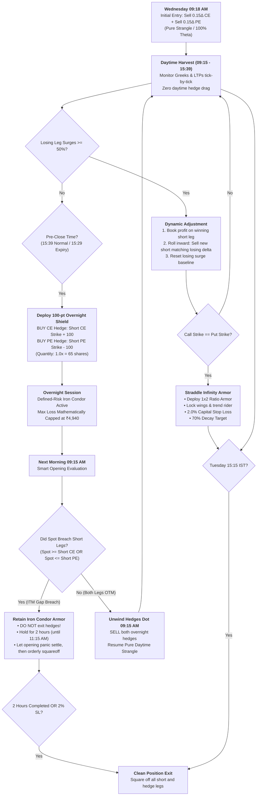

# NIFTY DELTA-NEUTRAL OPTION SELLING WITH 100-POINT DYNAMIC OVERNIGHT SHIELD
## Comprehensive Strategy Blueprint & Architecture Specification

---

## 1. STRATEGY PHILOSOPHY & EXECUTIVE SUMMARY (Saral Bhasha Mein)

Yeh strategy ek **Institutional-Grade, Fully Automated Positional Option Selling System** hai jo **NIFTY 50 Weekly Options** par trade karti hai via Angel One SmartAPI.

### Asli Problem Kya Thi? (The Tail Risk Dilemma)
Option selling mein sabse bada darr hota hai **Overnight Fat-Tail Gap Risk**:
1. **Din mein Hedge rakhne ka nuksan:** Agar hum din bhar OTM hedges (wings) buy karke rakhte hain, toh unka continuous theta decay hamare profit ka 40%–50% kha jata hai.
2. **Raat ke Black Swan Gap ka khatra:** Raat ko market closed hota hai. Agar koi badi global news aayi, toh agle din market 300–500 points ka direct discrete jump karta hai. Aise discrete opening gap mein market seedha stop-loss jump kar jata hai (₹30 ka option seedha ₹150 par khulta hai bina beech ke prices touch kiye).

### Hamara 2-Regime Solution (Daytime Harvest + Overnight 100-Pt Armor)
1. **Din Bhar (09:15 AM – 15:39 PM): Pure Theta Harvest Mode (Unhedged Strangle)**
   * Din mein koi hedge drag nahi hota. 100% time decay hamare account mein collect hota hai.
   * Tick-by-tick real-time monitoring: jab market trend karta hai aur losing short leg ka premium **50% surge** karta hai, algo automatically winning side ko profit mein book karta hai aur inward roll karke Net Delta ko 0.00 restore karta hai.
2. **Shaam ko 15:39 IST (1 Min Before 15:40 F&O Close): Dynamic 100-Point Overnight Shield**
   * Market band hone se theek 1 minute pehle (**15:39 IST**), algo active open short strikes ko check karta hai (chahe din bhar mein kitne bhi adjustments hue hon).
   * Exact **100-point gap** par Call aur Put dono taraf equal quantity (1.0x = 65 shares) ka OTM hedge BUY kar leta hai:
     * CE Hedge Strike = Active Short CE Strike + 100
     * PE Hedge Strike = Active Short PE Strike - 100
   * Isse overnight portfolio **Defined-Risk Iron Condor** ban jata hai jisme maximum possible loss mathematically capped hota hai (~₹4,940).
3. **Subah 09:15 AM: Smart Opening Evaluation Protocol**
   * Market open hote hi spot price ko short legs ke saath compare kiya jata hai:
     * **Normal Open (Dono Legs OTM):** Hedges ko dot 09:15 AM par exit kar diya jata hai. Position wapas pure daytime harvest mode mein aa jati hai.
     * **Gap Breach (Koi bhi Short Leg ITM ban gayi / 2σ Move):** **Hedge ko exit NAHI kiya jata!** Iron Condor armor ko active rakha jata hai taaki loss ₹4,940 se upar na jaye. Market ki subah ki panic aur wide spreads ko settle hone ke liye 2 ghante hold kiya jata hai, phir orderly exit hota hai.

---

## 2. SENSIBULL PAYOFF & RISK-REWARD ANALYSIS

22 Oct live market chain ke hisaab se Sensibull payoff metrics:

| Metric | Daytime (Without Overnight Hedge) | Overnight Session (With 100-pt Hedge) |
| :--- | :--- | :--- |
| **Short Legs** | Sell 0.15Δ CE (23100 @ ₹31) + Sell 0.15Δ PE (22300 @ ₹34) | Same short legs active |
| **Hedge Legs** | Zero daytime hedge (100% Theta) | Buy 23200 CE (@ ₹19.60) + Buy 22200 PE (@ ₹22.65) |
| **Hedge Distance** | N/A | **Exact 100-point OTM Wing** |
| **Max Profit** | ₹4,306 (+2.5% on capital) | ₹1,560 (+2.4% with full overnight carry) |
| **Max Loss** | Unlimited without hedge | **Strictly Capped at ₹4,940 (-8%)** |
| **Breach Threshold** | N/A | > 513 pts gap-up (+2.26%) ya < 487 pts gap-down (-2.15%) |
| **Loss:Reward Ratio** | Unfavorable (unhedged) | **1.15 : 1 (Controlled institutional risk profile)** |
| **Win Probability** | ~75% | Protected against 2σ+ tail risk events |

### Realistic P&L Expectancy:
* **Overnight Hedge Cost:** ~3–6 points per night (both sides combined).
* **Average Winning Week:** ₹2,750 – ₹3,500 net profit per lot.
* **Bad Week Max Loss:** Hard capped at ₹4,940 (extreme gap) ya ₹2,500–₹3,500 (normal adjustment loss).
* **Monthly Expectancy (3 Win, 1 Loss):** **+₹3,500 se +₹5,000 net per lot** (~5%–8% monthly ROI on utilized margin).

---

## 3. CORE CONFIGURATION & PARAMETERS

| Parameter | Value | Logic / Description |
| :--- | :--- | :--- |
| **Underlying Index** | NIFTY 50 (`NSE: 99926000`) | Benchmark Indian index |
| **Segment** | NFO (Weekly Options) | Tuesday weekly expiry contracts |
| **Lot Size** | 65 shares | Nifty exchange lot size |
| **Initial Strangle Entry** | 0.15 Delta Call + 0.15 Delta Put | Equal distance OTM short strangle (Wed 09:18 AM) |
| **Daytime Mode** | Pure Strangle (`DAYTIME_HEDGES_ENABLED = False`) | 100% pure theta decay capture |
| **Dynamic Adjustment Trigger** | 50% Short Premium Surge | Losing leg expands $\ge 50\%$ from baseline |
| **Overnight Shield Distance** | 100 points (`OVERNIGHT_SHIELD_WING_PTS = 100`) | CE: Short CE + 100, PE: Short PE - 100 |
| **Shield Quantity Multiplier** | 1.0x (`OVERNIGHT_SHIELD_QTY_MULTIPLIER = 1.0`) | 65 shares (equal to short leg quantity) |
| **Shield Deploy Timing (Expiry)** | 15:29 IST (`SHIELD_BUY_MINUTE_EXPIRY = 29`) | 1 min before 15:30 close on expiry days |
| **Shield Deploy Timing (Non-Expiry)** | 15:39 IST (`SHIELD_BUY_MINUTE_NON_EXPIRY = 39`) | Exactly 1 min before 15:40 F&O close |
| **Morning Evaluation Time** | 09:15 IST (`OVERNIGHT_SHIELD_SELL_MINUTE = 15`) | Dot market open evaluation |
| **Gap Breach Compensator** | Active Scenario 2.B Shift | Safe side harvested + Fresh ATM credit spread offset |
| **Straddle Convergence Setting** | `STRADDLE_PROXIMITY_PTS = 0` | When Short Call Strike == Short Put Strike |
| **Capital Stop Loss** | 2.0% of Dynamic Capital Base | Hard exit if total loss exceeds 2% of allocated capital |
| **Straddle Spot Breaker** | 1.25% Spot Distance | Hard exit if Nifty moves $\ge 1.25\%$ from straddle strike |
| **Straddle Profit Target** | 70% Combined Theta Decay | Full exit when straddle premium decays by $\ge 70\%$ |
| **OTM Full Decay Target** | Both short legs $\le ₹1.00$ | 100% profit capture if never converged to straddle |
| **Market Close (Expiry Day)** | 15:30 IST | Settlement timing for expiring index contracts |
| **Market Close (Non-Expiry Day)** | 15:40 IST | NSE Equity Derivatives Session Close |

---

## 4. LIFECYCLE & EXECUTION WORKFLOW

---

## 5. DETAILED OPERATIONAL MECHANICS

### Phase 1: Initial Entry (Wednesday 09:18 AM IST)
1. **Wait for Open Volatility to Settle:** 09:15 AM open se 3 minute ruk kar 09:18 AM par entry li jaati hai.
2. **Strike Selection:** Live option chain scan karke Black-Scholes model se Call aur Put dono side **0.15 Delta** ke OTM strikes select hote hain.
3. **Pure Selling:** Call aur Put dono sell hote hain (1 lot = 65 shares). Net Delta $\approx 0.00$.

### Phase 2: Daytime Dynamic Adjustments (50% Surge Rule)
1. **Trigger:** Agar Nifty trend karta hai aur losing short leg ka live premium uske baseline premium se **$\ge 50\%$ badh** jata hai.
2. **Execution:**
   - Losing short leg **khuli rehti hai** (extremes par loss book nahi karte). Uska baseline premium update hokar live price ban jata hai.
   - Winning short leg ko **turant BUY back karke profit lock** kar lete hain.
   - Losing leg ka live delta read karke winning side par **exact same target delta** ka naya short leg sell karte hain (inward roll).
   - Net Delta wapas **0.00** ho jata hai!

### Phase 3: Shaam Ka 100-Point Overnight Shield
1. **Dynamic Strike Detection:** Algo open short legs ko dekhta hai:
   - Call Hedge Strike = `Current Short CE Strike + 100`
   - Put Hedge Strike = `Current Short PE Strike - 100`
2. **Timing (NSE CAS F&O Rules):**
   - **Weekly Expiry Days (Tuesday):** Theek **15:15 IST** par position auto-squareoff ho jaati hai (cycle end).
   - **Regular Trading Days (Mon, Wed, Thu, Fri):** Theek **15:39 IST** par deploy hota hai (exactly 1 minute before 15:40 F&O close).
3. **Quantity:** 1.0x (65 shares = short leg quantity).

### Phase 4: Subah 09:15 AM Opening Protocol (ITM Gap Check)
1. **09:15 AM Market Open Evaluation:**
   - Spot price ko short legs ke strikes se check karte hain:
     $$\text{CE Breached} = (\text{Spot} \ge \text{Short CE Strike})$$
     $$\text{PE Breached} = (\text{Spot} \le \text{Short PE Strike})$$
2. **Scenario A — Normal Market Open (Dono Short Legs OTM):**
   - Overnight hedges ko **dot 09:15 AM par SELL** karke exit kar diya jata hai.
   - Position daytime harvest mode mein continue karti hai.
3. **Scenario B — Fat-Tail Gap Breach (Koi bhi Short Leg ITM ban gayi):**
   - **Breached Side Hedge Retain:** Breached short leg aur uska long hedge open rehta hai taaki spread loss ₹4,940 par strictly cap rahe.
   - **Active Counter-Adjustment (Scenario 2.B Credit Shift & Harvest):**
     1. Decayed safe side short leg + hedge ko turant harvest (close) karke maximum cash profit book karte hain.
     2. Live ATM spot strike par safe side fresh Credit Spread (Sell ATM + Buy ATM-100 wing) deploy karte hain.
     3. Fresh net credit loss ko 100% absorb aur counter-balance karta hai, position ko passive timeout surrender ke bajaye active profitable defense mein convert karta hai!

### Phase 5: Straddle Convergence & The Infinity Armor Engine
Jab adjustments karte-karte Call Strike == Put Strike ($K$) ho jaye, toh position **Short Straddle** ban jaati hai. Passive baithne ke bajaye, engine turant **Active Counter-Adjustments** execute karta hai:

1. **Scenario 1 — Naked Straddle Reached (Daytime):**
   - **Immediate 1x2 Ratio Armor Deployment:**
     - Tested Side (jis taraf trend tha): **BUY 2 Lots of $K \pm 100$** (1 wing + 1 trend rider = 1x2 Ratio Backspread).
     - Untested Side: **BUY 1 Lot of $K \mp 100$** (Protective wing).
   - **Mathematical Payoff:**
     - Margin ₹1.67L se girkar ~₹85,000 ho jata hai (~₹80k margin release).
     - Max tail loss hamesha ke liye cap ho jata hai.
     - Agar market trend continue karta hai, toh 2 Long wings position ko Net Long Delta (+1.00) dekar massive profit generate karti hain!

2. **Scenario 2 — Hedged Straddle (With Overnight Hedges):**
   - **Scenario 2.A (ATM):** Missing wing ko fill kiya jata hai aur tested wing par +1 lot add karke 1x2 Ratio Backspread banaya jata hai.
   - **Scenario 2.B (ITM Breached):** Tested side spread ka loss locked hai. Decayed safe side ko harvest (profit book) karke live ATM spot strike par fresh credit spread roll kiya jata hai, jo locked spread loss ko 100% absorb kar leta hai.

3. **Dynamic Capital Management & Exit Gates:**
   - **Dynamic Capital Base:** `max(ALLOCATED_CAPITAL_PER_LOT * Lots, Deployed Capital)` (Standard ₹2.00 Lakh base per lot).
   - **Armor Profit Target:** +2.0% ROI on capital base aate hi full exit.
   - **70% Straddle Decay Target:** Combined short legs 70% decay hote hi profit book.
   - **2.0% Strict Capital Stop Loss:** Dynamic capital base ka 2.0% (₹4,000 per lot).

---

## 6. AWS INFRASTRUCTURE & ARCHITECTURAL BEST PRACTICES

### Kya Hame Kubernetes (K8s) Ki Zaroorat Hai?
**Bilkul NAHI (Strict No):**
1. **K8s Web Apps ke liye hai, Trading Bots ke liye nahi:** K8s horizontal scaling ke liye bana hai (jaise e-commerce traffic badhne par 1 server se 10 server banana).
2. **Strict Single-Instance Requirement:** Trading bot ek **Stateful Single-Instance System** hota hai. Agar K8s galti se 2 pods chala de, toh dono pods same Angel One account par double orders place kar denge aur margin blow-up ho jayega!
3. **Overlay Network Latency:** K8s ke container networking (flannel/calico) aur kube-proxy internal network hops add karte hain. Algo trading mein direct bare-metal OS socket access sabse fast hota hai.
4. **Extra Cost:** AWS EKS control plane ka flat ~$73/month (~₹6,000/month) bina kisi fayde ke waste hota hai.

### AWS Par Performance Kaise Maximize Karein? (Top 5 Layers)
1. **AWS Region Colocation (Mumbai ap-south-1):**
   - Angel One ke servers aur NSE exchange Mumbai mein hain. EC2 instance `ap-south-1` mein hone se broker REST aur WebSocket ping **1ms – 3ms** rehta hai.
2. **EC2 Instance Family:**
   - `t4g.small` (ARM Graviton2) ya `c6i.large`: Inme Elastic Network Adapter (ENA) hota hai jo network jitter ko sub-millisecond rakhta hai aur burstable CPU throttling se bachata hai.
3. **Systemd Auto-Restart Daemon:**
   - Linux `systemd` daemon background mein bot ko run karta hai. Agar internet drop ho ya broker API reconnect ho, systemd 5 seconds mein process ko auto-recover kar leta hai bina state lose kiye.
4. **Precision NTP Time Sync:**
   - EC2 par AWS Time Sync Service (`169.254.169.123`) configured hona chahiye taaki 15:44:00 aur 09:15:00 par exact microsecond accuracy ke saath orders trigger hon.
5. **Operational Telemetry (Alerting Layer):**
   - Jab 15:44 par hedge buy ho, ya 09:15 par gap breach detect ho, ya 2% capital SL hit ho, Telegram webhook ke through trader ke mobile par instant notification aana chahiye.

---

*Blueprint Version: 3.0 (100-Point Dynamic Overnight Shield & SEBI CAS Adaptation)*  
*Last Updated: 2026-10-22*
